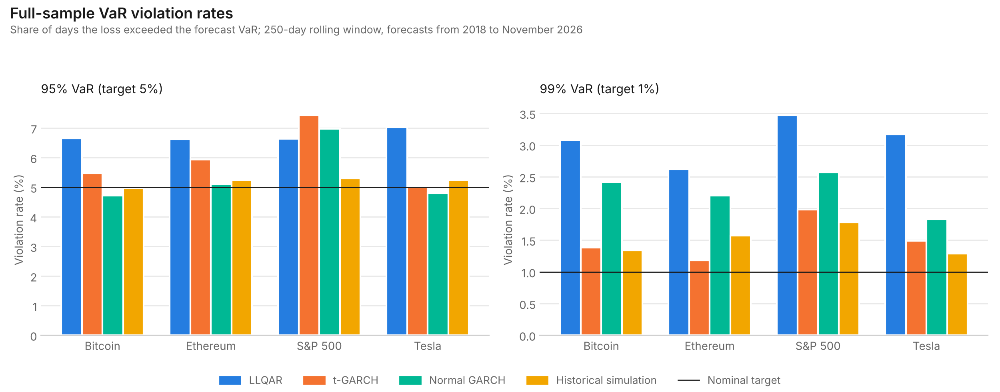
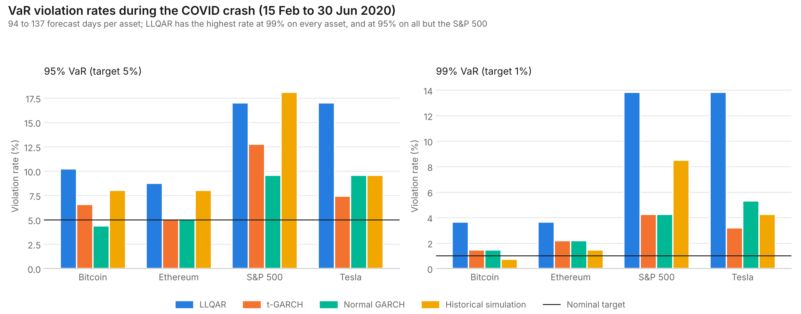
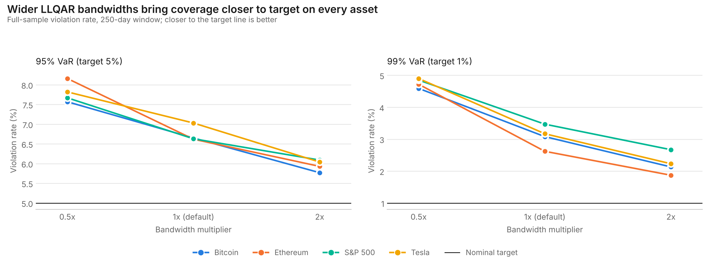

# LLQAR vs GARCH: Value-at-Risk Backtesting on Crypto and Equities

A rolling out-of-sample backtest of one-day-ahead Value-at-Risk (VaR) forecasts for Bitcoin, Ethereum, Tesla and the S&P 500. It tests whether the local linear quantile autoregression (LLQAR) method proposed by Kamronnaher et al. (2024) beats standard GARCH models, and whether any advantage appears in crisis periods.

> **Headline result.** In this implementation, LLQAR does **not** outperform GARCH or plain historical simulation. It has the highest pinball loss on every asset at both confidence levels, its only coverage advantage is over the GARCH models on the S&P 500 at 95%, and it is weakest in sudden-shock regimes such as the COVID crash. The result is a negative one, and the [limitations](#limitations) section explains how far it can be generalised.

## Contents

1. [Key findings](#key-findings)
2. [Research question](#research-question)
3. [Data](#data)
4. [Methodology](#methodology)
5. [Results](#results)
6. [Comparison with the source paper](#comparison-with-the-source-paper)
7. [Limitations](#limitations)
8. [Reproducing the results](#reproducing-the-results)
9. [Repository structure](#repository-structure)
10. [References](#references)

## Key findings

- **LLQAR is the worst-calibrated model at the 99% level on all four assets.** Its violation rate is 2.6% to 3.5% against a 1% target, and both the Kupiec and Christoffersen tests reject it in all 8 asset-and-level cases.
- **At 95%, LLQAR is the worst model on Bitcoin, Ethereum and Tesla** (6.6% to 7.0% against 5%). On the S&P 500 it sits between historical simulation (5.3%) and the GARCH models (7.0% and 7.4%).
- **Historical simulation is hard to beat.** At 95% it is within 0.3 percentage points of the target on every asset, and t-GARCH is the best 99% model on Ethereum.
- **Crisis regimes do not rescue LLQAR.** During the COVID crash (15 Feb to 30 Jun 2020), LLQAR breached its 99% VaR on 13.8% of days for both the S&P 500 and Tesla, against 3% to 5% for the GARCH models. Its one competitive result is 95% coverage in the 2022 crypto collapse.
- **LLQAR's coverage improves steadily as its bandwidth widens**, on every asset and at both levels. That points to the local weighting adding noise at a 250-day window.
- **The two readings of the paper's ambiguous time-lag weight give near-identical results** (within about half a percentage point), so that ambiguity does not drive the conclusion.

## Research question

> Does a flexible, nonparametric tail-risk model (LLQAR) forecast Value-at-Risk better than standard GARCH models, and does any advantage appear only in crisis regimes?

The source paper reports that LLQAR performs well for 95% VaR and is competitive in non-stationary settings, while GARCH models do better in stationary ones. Crypto assets and a volatile stock stress those claims harder than the large-cap equities the paper tested, and the S&P 500 acts as a lower-volatility control.

**Scope.** This project covers VaR only. Expected Shortfall is excluded because the paper does not specify how LLQAR produces it, so any ES comparison would rest on my own construction.

## Data

Daily closing prices from Yahoo Finance via `yfinance`, running to 23 to 24 November 2026 (adjusted for splits and dividends where applicable).

| Asset | Ticker | Prices | Daily losses | Forecast days (250-day window) |
|---|---|---:|---:|---:|
| Bitcoin | `BTC-USD` | 3,303 | 3,302 | 3,052 |
| Ethereum | `ETH-USD` | 3,303 | 3,302 | 3,052 |
| Tesla | `TSLA` | 2,271 | 2,270 | 2,020 |
| S&P 500 | `^GSPC` | 2,271 | 2,270 | 2,020 |

All series start on 9 November 2017, the earliest reliable Ethereum history. Forecasts begin once the first 250-day window is filled (mid-2018 for the crypto assets, late 2018 for the equities). Crypto trades every day and the equities only on market days, so a 250-day window covers about 8 months for crypto and about one year for the equities. A 365-day crypto window is included as a robustness check.

## Methodology

### Losses and forecasting protocol

The daily loss is the negative log return, $L_t = -\ln(P_t / P_{t-1})$. The 95% and 99% VaR forecasts (tail probabilities $\tau = 0.05$ and $0.01$) are the $(1-\tau)$ quantile of the next day's loss.

Every forecast is **out of sample**. For each day $t$, each model is refit on only the previous 250 losses and forecasts day $t$. A **violation** is a day when the realised loss exceeds the forecast VaR. A well-calibrated model has a violation rate equal to $\tau$ and violations that are not clustered.

### Models

| Model | How it forecasts VaR |
|---|---|
| **Historical simulation** | The empirical $(1-\tau)$ quantile of the last 250 losses. The no-model baseline. |
| **Normal GARCH** | GARCH(1,1) with a constant mean and normal innovations. VaR = $\mu + \sigma_{t+1}\, z_{1-\tau}$. |
| **t-GARCH** | The same with Student-t innovations, using the unit-variance t quantile. |
| **LLQAR** | Local linear quantile autoregression, described below. |

GARCH models are estimated by quasi-maximum likelihood with the [`arch`](https://github.com/bashtage/arch) package. The next-day volatility $\sigma_{t+1}$ is the model's one-step variance forecast.

### LLQAR

LLQAR forecasts the tail directly, with no volatility model and no distributional assumption. It regresses each loss on the previous day's loss, but gives more weight to past days whose previous loss resembled today's:

$$
\min_{a,\,b}\ \sum_{s} w_s\, \rho_{1-\tau}\!\big(L_s - a - b\,(L_{s-1} - L_T)\big), \qquad \mathrm{VaR}_{T+1} = \hat a
$$

where $\rho_q(u) = u\,(q - \mathbf 1\{u<0\})$ is the quantile check loss and $L_T$ is today's loss. The intercept $\hat a$ is the local quantile of tomorrow's loss at today's loss level. Each fit is a weighted linear program, solved with HiGHS.

The weights are Gaussian-kernel weights on a distance that combines loss similarity with a time-lag factor:

$$
w_s = \exp\!\Big(-\tfrac12 (d_s/h)^2\Big), \qquad d_s = |L_{s-1} - L_T| \cdot g(\text{lag}_s), \qquad h = m \cdot \big(\tfrac{4}{3n}\big)^{1/5} \,\mathrm{IQR}(d)
$$

The bandwidth $h$ follows the paper's interquartile-range rule, scaled by a multiplier $m$ (1 by default).

**Where I had to interpret the paper.** The paper's weight formula contains an undefined term, and its kernel is described only as "a kernel function". The implementation therefore includes two readings of the time-lag factor $g$, both reported:

| Variant | Time-lag factor $g(\text{lag})$ | Intent |
|---|---|---|
| `inflate` (default) | $1 + \text{lag}/(T-1)$ | Older observations are treated as further away, matching the paper's description that weights fall with age. |
| `literal` | $(\text{lag}+1)/(2\,\text{lag})$ | The mean of the printed expression. It is nearly flat over time. |

The paper's cross-validated bandwidth selector specifies no search grid, so it is not implemented. Instead, bandwidth multipliers of 0.5, 1 and 2 are tested as a sensitivity analysis.

### Evaluation

| Metric | What it tells you |
|---|---|
| **Violation rate** | The share of days the loss exceeded the VaR. Should equal $\tau$. |
| **Kupiec test** | Tests whether the violation rate differs from $\tau$ (unconditional coverage). |
| **Christoffersen test** | Tests coverage and independence of violations, so clustered breaches are penalised (conditional coverage). |
| **Pinball loss** | The average quantile check loss of the forecast. Lower is better. It is a proper scoring rule, so it rewards forecasts that are both calibrated and tight. |

**Regime analysis.** Violation rates and pinball loss are also computed within calendar windows fixed before results were seen: the 2018 sell-off, the COVID crash (15 Feb to 30 Jun 2020), the 2021 bubble and the 2022 collapse. Every other day is "Other".

## Results

Unless stated otherwise, all models use a 250-day rolling window. Cells show the **95% / 99%** value; the targets are 5% and 1%.

### Full sample



**Violation rate (%)**

| Asset | Historical simulation | Normal GARCH | t-GARCH | LLQAR |
|---|---:|---:|---:|---:|
| Bitcoin | 5.0 / 1.3 | 4.7 / 2.4 | 5.5 / 1.4 | 6.7 / 3.1 |
| Ethereum | 5.2 / 1.6 | 5.1 / 2.2 | 5.9 / 1.2 | 6.6 / 2.6 |
| S&P 500 | 5.3 / 1.8 | 7.0 / 2.6 | 7.4 / 2.0 | 6.6 / 3.5 |
| Tesla | 5.2 / 1.3 | 4.8 / 1.8 | 5.0 / 1.5 | 7.0 / 3.2 |

**Pinball loss (×10³, lower is better)**

| Asset | Historical simulation | Normal GARCH | t-GARCH | LLQAR |
|---|---:|---:|---:|---:|
| Bitcoin | 3.8 / 1.3 | 3.7 / 1.3 | 3.7 / 1.3 | 4.6 / 2.6 |
| Ethereum | 5.1 / 1.7 | 5.1 / 1.8 | 5.0 / 1.7 | 6.0 / 2.8 |
| S&P 500 | 1.6 / 0.6 | 1.3 / 0.4 | 1.3 / 0.4 | 1.9 / 1.0 |
| Tesla | 4.7 / 1.6 | 4.5 / 1.5 | 4.5 / 1.5 | 5.5 / 2.5 |

**Coverage tests rejected at the 5% level (of 8 asset-and-level cases)**

| Model | Kupiec rejections | Christoffersen rejections |
|---|---:|---:|
| Historical simulation | 2 of 8 | 5 of 8 |
| Normal GARCH | 5 of 8 | 5 of 8 |
| t-GARCH | 5 of 8 | 3 of 8 |
| LLQAR | 8 of 8 | 8 of 8 |

LLQAR has the highest pinball loss on every asset at both levels, so it is both less well calibrated and less accurate than the alternatives. The GARCH models over-violate on the S&P 500 at 95% (7.0% and 7.4%), well above historical simulation (5.3%).

### Crisis regimes



The crypto rows in the regime tables use the 365-day window; the S&P 500 and Tesla rows use 250 days.

**COVID crash, violation rate (%)**: 137 forecast days for the crypto assets, 94 for the equities.

| Asset | Historical simulation | Normal GARCH | t-GARCH | LLQAR |
|---|---:|---:|---:|---:|
| Bitcoin | 8.0 / 0.7 | 4.4 / 1.5 | 6.6 / 1.5 | 10.2 / 3.6 |
| Ethereum | 8.0 / 1.5 | 5.1 / 2.2 | 5.1 / 2.2 | 8.8 / 3.6 |
| S&P 500 | 18.1 / 8.5 | 9.6 / 4.3 | 12.8 / 4.3 | 17.0 / 13.8 |
| Tesla | 9.6 / 4.3 | 9.6 / 5.3 | 7.4 / 3.2 | 17.0 / 13.8 |

**COVID crash, pinball loss (×10³)**

| Asset | Historical simulation | Normal GARCH | t-GARCH | LLQAR |
|---|---:|---:|---:|---:|
| Bitcoin | 6.9 / 3.7 | 7.5 / 4.2 | 7.1 / 3.9 | 9.0 / 15.7 |
| Ethereum | 8.9 / 4.8 | 9.7 / 5.4 | 8.8 / 4.9 | 19.2 / 14.7 |
| S&P 500 | 6.6 / 3.1 | 3.7 / 1.3 | 3.8 / 1.2 | 7.8 / 6.3 |
| Tesla | 10.1 / 3.4 | 8.7 / 3.2 | 8.9 / 2.7 | 10.0 / 4.7 |

LLQAR has the highest 99% violation rate on all four assets, and the highest 95% rate on all except the S&P 500, where historical simulation is slightly higher. On the S&P 500, LLQAR's pinball loss is about twice the GARCH models' at 95% and about five times at 99%. A likely reason is that LLQAR conditions on the size of the previous loss within a window that, at the start of the crash, holds only calm history. It has no volatility model to scale its forecasts up when conditions change quickly, and neither does historical simulation, which also breaches its 95% VaR on 18.1% of S&P 500 days here. This explanation is consistent with the results but has not been tested directly.

**2022 collapse, violation rate (%)**: 365 forecast days for crypto, 251 for equities.

| Asset | Historical simulation | Normal GARCH | t-GARCH | LLQAR |
|---|---:|---:|---:|---:|
| Bitcoin | 4.4 / 1.4 | 5.2 / 2.5 | 5.8 / 2.5 | 5.2 / 3.0 |
| Ethereum | 5.8 / 1.6 | 7.4 / 2.7 | 7.7 / 2.5 | 5.8 / 2.5 |
| S&P 500 | 9.2 / 4.0 | 9.6 / 2.8 | 8.8 / 2.0 | 11.2 / 6.8 |
| Tesla | 10.0 / 1.6 | 7.6 / 1.6 | 8.0 / 1.2 | 12.0 / 4.0 |

The 2022 crypto collapse is the one case where LLQAR is competitive: its 95% rate matches or beats the GARCH models on Bitcoin and Ethereum. A slower, grinding decline is a different kind of stress from a sudden shock. This rests on two highly correlated assets, so treat it as a hypothesis. On the S&P 500 and Tesla, LLQAR is again worse than GARCH.

**2021 bubble, violation rate (%)**

| Asset | Historical simulation | Normal GARCH | t-GARCH | LLQAR |
|---|---:|---:|---:|---:|
| Bitcoin | 7.7 / 1.6 | 4.9 / 2.5 | 6.3 / 1.6 | 8.8 / 3.6 |
| Ethereum | 6.0 / 1.1 | 5.5 / 1.6 | 6.0 / 1.4 | 7.4 / 3.3 |
| S&P 500 | 2.4 / 0.4 | 4.0 / 2.0 | 5.2 / 1.6 | 4.4 / 0.8 |
| Tesla | 4.4 / 0.4 | 4.4 / 1.2 | 4.0 / 1.2 | 5.6 / 2.0 |

The 2018 sell-off window has only 35 to 52 forecast days per asset, too few to interpret, so it is left out of the tables. It is in `regimes_all.csv` for completeness.

### Sensitivity analysis



**Bandwidth multiplier, violation rate (%)**

| Asset | LLQAR, bandwidth 0.5x | LLQAR | LLQAR, bandwidth 2x |
|---|---:|---:|---:|
| Bitcoin | 7.6 / 4.6 | 6.7 / 3.1 | 5.8 / 2.1 |
| Ethereum | 8.2 / 4.7 | 6.6 / 2.6 | 5.9 / 1.9 |
| S&P 500 | 7.7 / 4.9 | 6.6 / 3.5 | 6.1 / 2.7 |
| Tesla | 7.8 / 4.9 | 7.0 / 3.2 | 6.0 / 2.2 |

**Bandwidth multiplier, pinball loss (×10³)**

| Asset | LLQAR, bandwidth 0.5x | LLQAR | LLQAR, bandwidth 2x |
|---|---:|---:|---:|
| Bitcoin | 5.0 / 2.5 | 4.6 / 2.6 | 4.0 / 1.9 |
| Ethereum | 19.6 / 16.9 | 6.0 / 2.8 | 5.4 / 2.4 |
| S&P 500 | 2.1 / 1.2 | 1.9 / 1.0 | 1.7 / 0.9 |
| Tesla | 5.9 / 3.0 | 5.5 / 2.5 | 4.9 / 2.0 |

Wider bandwidths bring coverage closer to the target on every asset at both levels, and doubling the bandwidth lowers pinball loss on every asset. Narrow bandwidths are unstable: Ethereum's pinball loss at 0.5x is more than three times its default value, which suggests occasional extreme forecasts when the weights concentrate on very few days. Even at 2x, LLQAR's pinball loss stays above that of GARCH and historical simulation on every asset.

**Time-lag weight reading, violation rate (%)**

| Asset | LLQAR | LLQAR, literal lag weight |
|---|---:|---:|
| Bitcoin | 6.7 / 3.1 | 6.6 / 3.4 |
| Ethereum | 6.6 / 2.6 | 6.9 / 3.1 |
| S&P 500 | 6.6 / 3.5 | 6.9 / 3.7 |
| Tesla | 7.0 / 3.2 | 7.2 / 3.5 |

The two readings differ by about half a percentage point at most.

**Crypto window length: 365-day window, violation rate (%)**

| Asset | Historical simulation | Normal GARCH | t-GARCH | LLQAR |
|---|---:|---:|---:|---:|
| Bitcoin | 4.9 / 1.2 | 4.4 / 2.1 | 5.3 / 1.2 | 6.1 / 2.7 |
| Ethereum | 5.0 / 1.3 | 4.8 / 1.9 | 5.5 / 1.2 | 6.1 / 2.4 |

A longer window helps LLQAR modestly and leaves the other models roughly unchanged, so the ranking does not change.

## Comparison with the source paper

The paper's backtest uses a 250-day rolling window on the S&P 500, IBM, Apple and Walmart from January 2007 to November 2022. Only the S&P 500 overlaps with this project's assets. Its reported S&P 500 violation rates, next to this project's:

| S&P 500 | Paper (2007 to 2022) | This project (2018 to 2026) |
|---|---:|---:|
| LLQAR, 95% | 4.7% | 6.6% |
| t-GARCH, 95% | 5.7% | 7.4% |
| Normal GARCH, 95% | 5.6% | 7.0% |
| LLQAR, 99% | 1.6% | 3.5% |
| t-GARCH, 99% | 1.7% | 2.0% |

The direction at 95% agrees: LLQAR has a lower violation rate than both GARCH models on the S&P 500 in both studies. At 99%, the paper reports LLQAR and t-GARCH at nearly identical rates (1.6% and 1.7%), and its coverage tests reject both on the S&P 500. Here, LLQAR is well above t-GARCH (3.5% against 2.0%) and is rejected as well.

The levels differ, however. The paper's LLQAR is closer to nominal coverage than mine, even though its sample includes 2008 and COVID. The most likely explanation is that my LLQAR behaves differently from theirs, most plausibly in the bandwidth, where wider values move my results toward theirs but do not reach them. Because the project has not been run on the paper's exact assets and dates, it is a **partial replication**: it reproduces the qualitative 95% ordering on the S&P 500 but not the paper's absolute levels.

## Limitations

- **LLQAR specification.** The weight formula, kernel form and cross-validated bandwidth are not fully specified in the paper, so conclusions apply to this implementation of LLQAR and not necessarily to the authors' own.
- **Partial replication.** The paper's exact assets and sample period (including IBM, Apple and Walmart) were not run, so the comparison with its tables above is indicative.
- **Small crisis samples.** The COVID windows contain 94 and 137 forecast days, and violations cluster, so the effective sample is smaller than the day count. The 99% crisis rates rest on a handful of violations.
- **Bitcoin and Ethereum are highly correlated**, so they give about one and a half independent pieces of evidence, not two.
- **No formal test of forecast-accuracy differences.** The comparisons use coverage tests and pinball loss descriptively. A Diebold-Mariano style test would be needed to claim a statistically significant ranking.
- **Multiple comparisons.** Four assets, seven model variants, two levels and several tests will produce some rejections by chance, so look for patterns across assets rather than single p-values.
- **Calendar regimes.** Regime windows are fixed by date and are not volatility-based, and the crypto regime tables use a different window length from the equity ones.
- **VaR only.** Expected Shortfall is out of scope.

## Reproducing the results

Requires Python 3.10 or newer; developed on Python 3.12.

```bash
python -m venv .venv
source .venv/bin/activate          # Windows: .venv\Scripts\activate
pip install -r requirements.txt

python fetch_data.py                                              # downloads data/*.csv
python main.py --data data --out results_250                      # 250-day window, all assets
python main.py --data data --out results_365 --window-crypto 365  # 365-day window for BTC and ETH
python make_figures.py                                            # regenerates figures/
```

Useful options for `main.py`:

| Option | Purpose |
|---|---|
| `--window N` | Rolling window length for all assets (default 250). |
| `--window-crypto N` | Override the window for the Bitcoin and Ethereum files only. |
| `--workers N` | Number of CPU processes for the rolling refits. |
| `--max-steps N` | Forecast only the first N windows, for a quick test. |

Each run writes per-asset forecast, backtest and regime CSVs, a combined `backtest_all.csv` and `regimes_all.csv`, and a plot per asset. `data/` and `results*/` are git-ignored.

## Repository structure

```
.
├── main.py              # rolling forecasts, backtests and regime tables
├── fetch_data.py        # downloads prices from Yahoo Finance
├── make_figures.py      # builds the figures in this README from the results
├── requirements.txt
├── figures/             # charts used in this README
└── README.md
```

## References

- Kamronnaher, K., Bellucco, A., Huang, W. K., & Gallagher, C. M. (2024). *Estimating Value at Risk and Expected Shortfall: A Brief Review and Some New Developments.* arXiv:2405.06798.
- Bollerslev, T. (1986). Generalized autoregressive conditional heteroskedasticity. *Journal of Econometrics*, 31(3), 307-327.
- Koenker, R., & Bassett, G. (1978). Regression quantiles. *Econometrica*, 46(1), 33-50.
- Yu, K., & Jones, M. C. (1998). Local linear quantile regression. *Journal of the American Statistical Association*, 93(441), 228-237.
- Kupiec, P. H. (1995). Techniques for verifying the accuracy of risk measurement models. *Journal of Derivatives*, 3(2), 73-84.
- Christoffersen, P. F. (1998). Evaluating interval forecasts. *International Economic Review*, 39(4), 841-862.
